# Meals - A Delicious Journey

Discover meals, explore recipes, and keep your favorite dishes close at hand. **Meals** helps you find something to cook, whether you know what you are looking for or just need inspiration.

## Features

- Browse a selection of random meals and see what's trending.
- Search for meals by name or find recipes by their first letter.
- Explore recipes by country, category, or ingredient.
- View recipe details, including ingredients, measurements, preparation instructions, and an optional video.
- Save favorite recipes on your device for later.
- Share a recipe with others.

## Screenshots

| Home | Explore | Search by name |
|---|---|---|
| 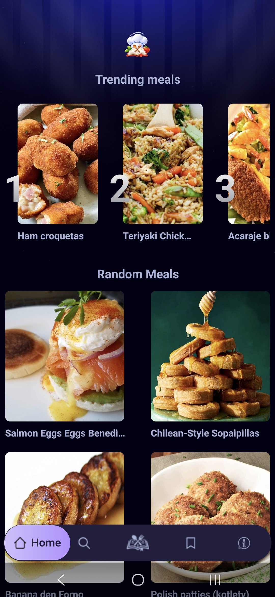 | 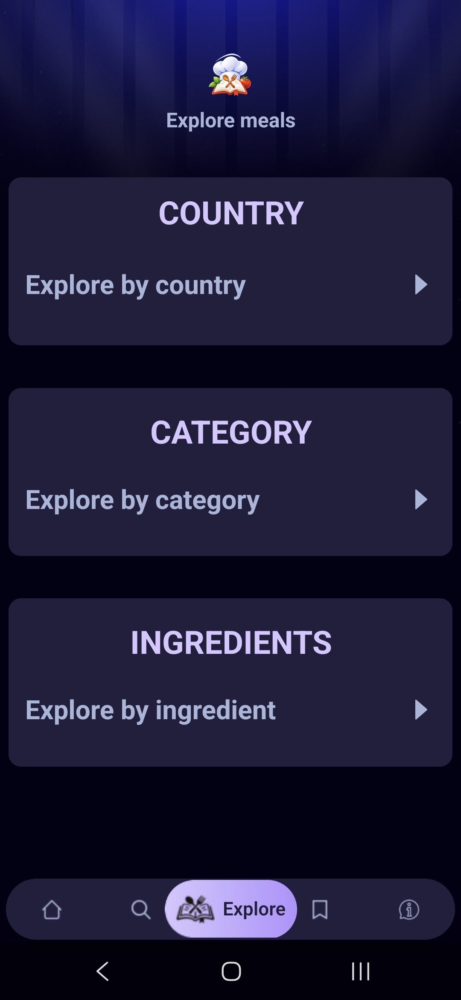 | 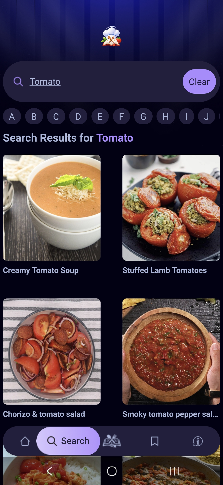 |

| Search by first letter | Explore by country | Explore by category |
|---|---|---|
| 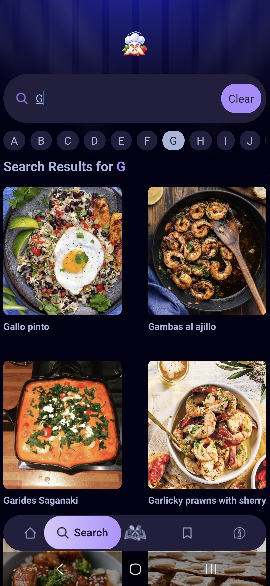 | 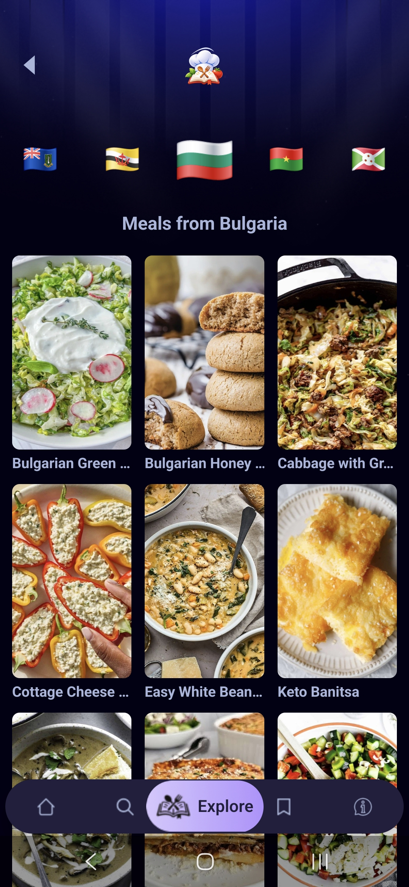 | 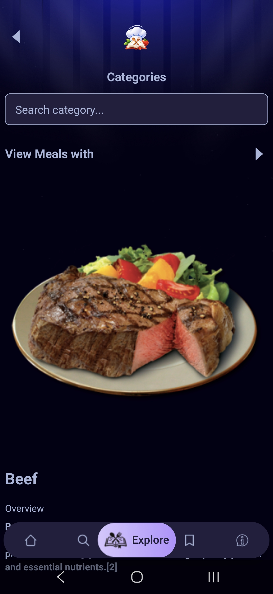 |

| Browse ingredients | Ingredient results | Recipe details |
|---|---|---|
| 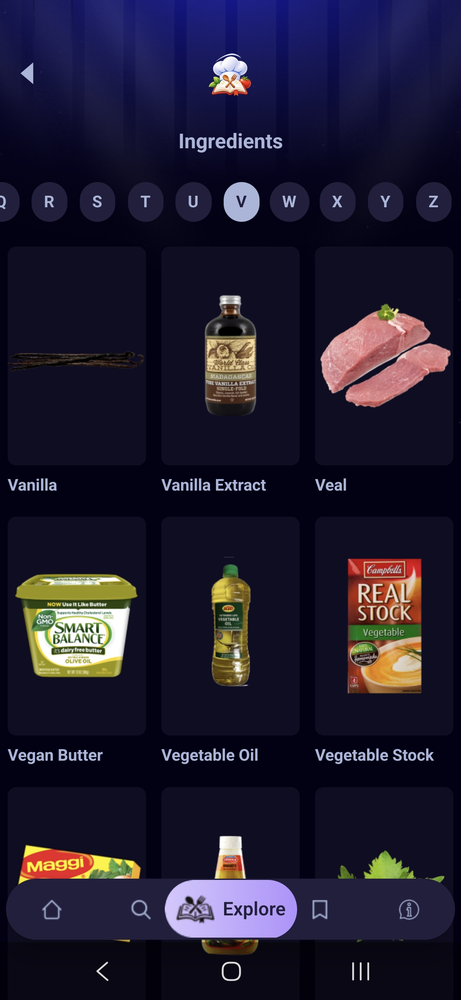 | 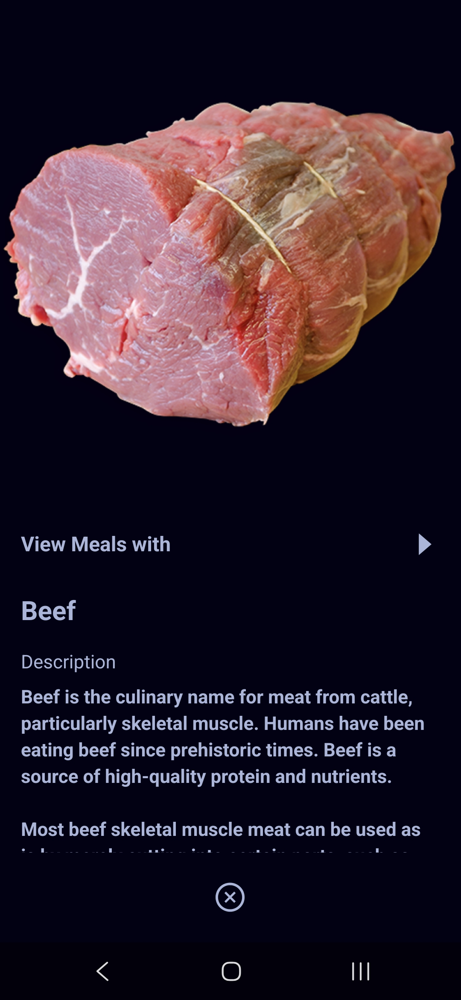 | 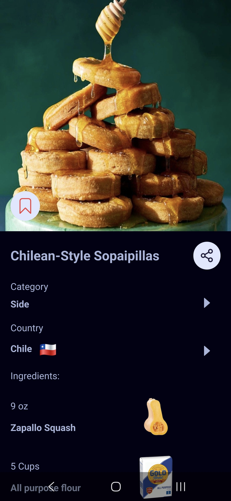 |

| Saved recipe details | Saved recipes | About |
|---|---|---|
| 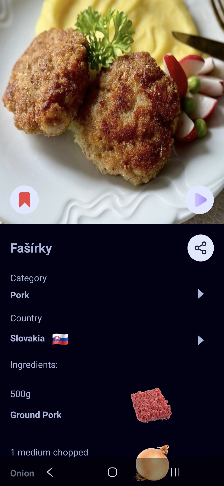 | 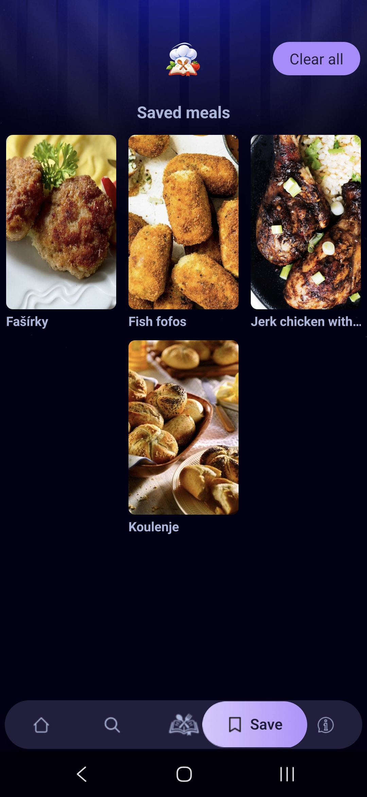 | 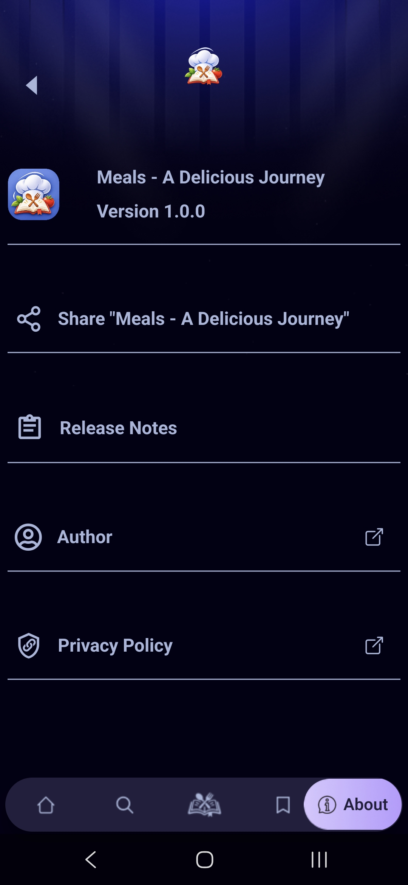 |

## Built with

- [Expo](https://expo.dev/) and [React Native](https://reactnative.dev/)
- TypeScript, Expo Router, and NativeWind
- [TheMealDB API](https://www.themealdb.com/api.php) for meal recipes
- A separately hosted trending service for popular searches

## Getting started

### Prerequisites

- Node.js and npm
- TheMealDB API access
- A deployed trending service that provides `/top` and `/increment` endpoints
- Expo Go for running the app on a physical device, or an Android/iOS simulator

### Install and configure

1. Install the project dependencies:

   ```sh
   npm install
   ```

2. Create a local environment file by copying `.env.example` to `.env`:

   **Windows PowerShell**

   ```powershell
   Copy-Item .env.example .env
   ```

   **macOS / Linux**

   ```sh
   cp .env.example .env
   ```

3. Set the values in `.env`:

   ```dotenv
   EXPO_PUBLIC_BASE_URL=https://www.themealdb.com/api/json/v2
   EXPO_PUBLIC_API_KEY=<your-TheMealDB-api-key>
   EXPO_PUBLIC_TRENDING_API_URL=<your-trending-service-base-url>
   ```

   The trending service base URL should not include `/top` or `/increment`; the app appends those paths. Variables prefixed with `EXPO_PUBLIC_` are included in the client app, so only use API credentials intended to be public.

### Run the app

Start the Expo development server:

```sh
npm start
```

Then open the app in Expo Go or a simulator. You can also use the platform-specific scripts:

```sh
npm run android
npm run ios
npm run web
```

Run the linter with:

```sh
npm run lint
```

### Production build

An Android production build can be started with EAS CLI:

```sh
npx eas-cli build --platform android --profile production
```

## Data and privacy

Meal recipes are fetched from TheMealDB. Saved recipes are stored locally on the device using AsyncStorage. Trending results and search counts are provided by the configured trending service.

## Help and contributions

For help or to report a problem, open an issue in the repository where you found this project. Contributions are welcome: open a pull request with a clear description of the change and any relevant testing.

## Maintainers

This project is maintained by its repository owner and contributors. See the repository's issue tracker for support and project discussions.

## License

See [LICENSE](LICENSE) for the license included with this repository.